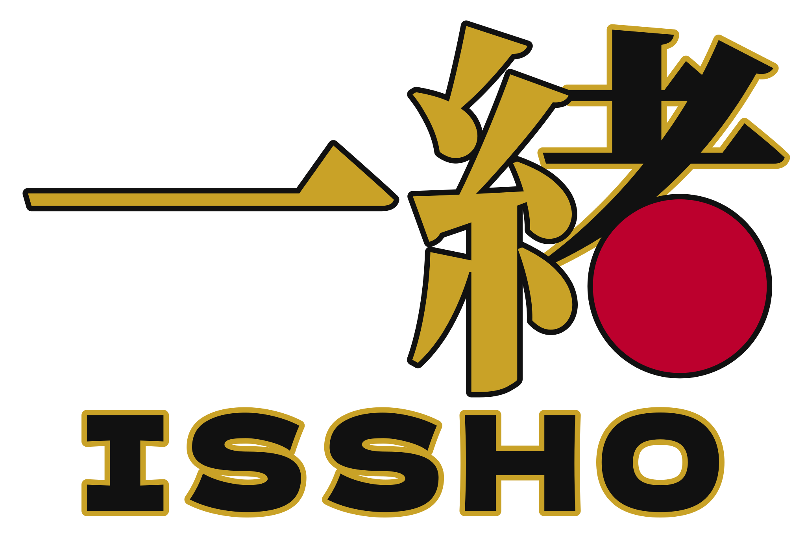
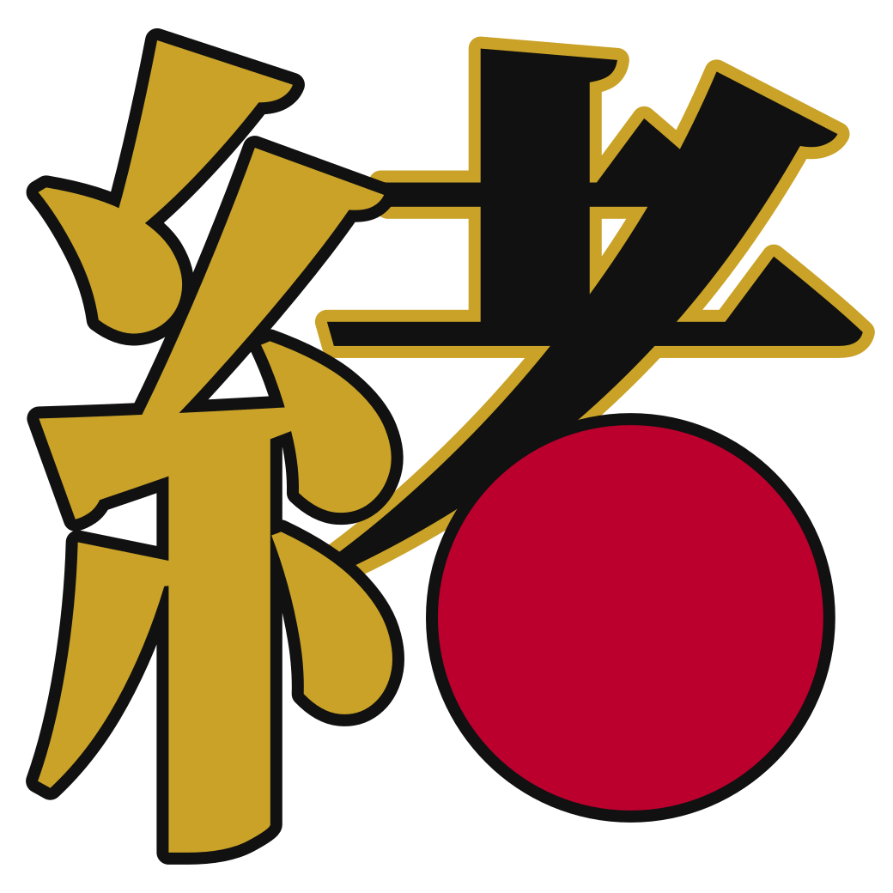

# Brand

  
  &nbsp;&nbsp;&nbsp;
  

## Concept

The logo is the word **一緒** (*issho*, "together"), with each part of the kanji given a role:

| Element | Kanji meaning | Treatment |
|---|---|---|
| 一 | "one" | A single **gold** stroke, the thread that starts it all |
| 糸 (left side of 緒) | "thread" | **Gold**, continuing the thread from 一 |
| 土 + ノ (top of 者) | part of 者, "person" | **Black** ink. The sun and thread sit on top of it. |
| 日 (bottom of 者) | "sun" | Replaced by a **red sun** disc in shu (朱), the vermilion of torii gates and seals |

Read together, it says: *one thread joining people under one sun*. Small groups, tied together, out in the world.

Every shape is outlined in a contrasting brand colour: **black parts have a gold outline**, and **gold and red parts have a black outline**. That's why a single version of the logo works on any background, light or dark. There are no alternate colour versions.

## Files

| File | Use |
|---|---|
| `logo.svg` | Full lockup (一緒 + ISSHO) |
| `mark.svg` | Square mark (緒 only) for app icons, favicons and avatars |

Both work on any background colour.

All files are pure vector paths, so no font is needed to display them.

## Typography

| Element | Font |
|---|---|
| Kanji 一緒 | **Noto Serif JP** (weight 800), with parts recoloured as above |
| Wordmark "ISSHO" | **Dela Gothic One**: a chunky, Japanese-designed display face that contrasts with the brush-like kanji |

Both are drawn as vector outlines, so no font needs to be installed to show the logo.

## Colours

| Name | Hex | Use |
|---|---|---|
| Shu sun | `#DA4528` | The sun. Use sparingly, as the single focal point. |
| Kogane gold | `#DEA92C` | The thread (一 and 糸), and the outline around black |
| Ai-black ink | `#131B40` | Kanji strokes and wordmark, and the outline around gold and red: indigo so dark it reads as black |

Recoloured on 2026-10-26 from hinomaru red `#BC002D`, gold `#C9A227` and ink `#111111`, with the app's Kogane palette ([docs/design-system.md](../../docs/design-system.md)). The concept and shapes are unchanged.

## Usage

- Always use these files as they are. Don't recolour parts, make dark or light versions, remove the outlines, add effects or rearrange the kanji. The meaning depends on each part keeping its colour.
- Keep clear space around the logo of at least the width of the red sun.
- At sizes below 32 px, use `mark.svg`.

## Regenerating

**App icons and splash** (`apps/mobile/assets/images/`) come from `mark.svg` via [`scripts/brand/build_app_icons.py`](../../scripts/brand/build_app_icons.py) (`make app-icons`, needs `rsvg-convert`): the mark on Ai night for the icon and favicon, transparent for Android's adaptive foreground and the splash, and a white silhouette for Android's themed icon and notifications. Rerun it after rebuilding the mark.

The SVGs are generated by [`scripts/brand/build_logo.py`](../../scripts/brand/build_logo.py) from **Noto Serif JP** (© Adobe, distributed by Google Fonts) and **Dela Gothic One** (© The Dela Gothic Project Authors) outlines. Usage is in the script's docstring. Both fonts are licensed under the [SIL Open Font License 1.1](https://openfontlicense.org), which permits using their outlines in artwork such as logos. The font files themselves are not committed.
